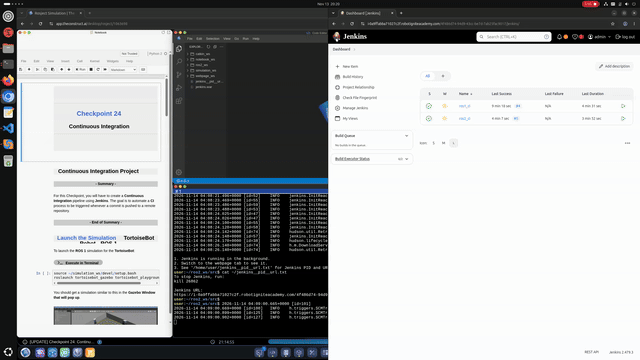

# ros1_ci

Jenkins CI for the Checkpoint 23 `tortoisebot_waypoints` tests (ROS Noetic, TortoiseBot simulation in Gazebo)

## Packages
- `tortoisebot/` - TortoiseBot simulation packages
- `tortoisebot_waypoints/` - waypoints action server and tests from Checkpoint 23
  - `launch/waypoints_sim.launch` (simulation with Gazebo GUI + action server, `gui:=false` without GUI)
- `ros1_ci/` - Checkpoint 24 files (this folder):
  - `Dockerfile` - ROS Noetic + Gazebo image with both packages built
  - `run_waypoints_test.sh` - runs in the container: 
    1. Starts the simulation
    2. Runs tests
    3. Shuts Gazebo down
  - `install_docker.sh` - installs and starts Docker in the rosject
  - `install_jenkins_plugins.sh` - downloads the Jenkins plugins (Pipeline + Git), versions for Jenkins 2.479.3
  - `start_jenkins.sh` - starts Docker and Jenkins (Jenkins home `~/webpage_ws/jenkins`)
  - `setup_deploy_key.sh` - creates the GitHub SSH key Jenkins uses to read this repository and adds github.com to known hosts
  - `Jenkinsfile` - Jenkins pipeline: 
    1. Builds Docker image
    2. Runs tests in container

## Docker setup

The rosject does not come with Docker. Installation and execution needed

```bash
bash ~/simulation_ws/src/ros1_ci/install_docker.sh
```

Notes:
- `install_docker.sh` is The Construct's `~/ros2_ws/src/fastbot/docker/install_docker.sh` with no prompts, plus:
  - `containerd.io` 1.7.23 (held), includes runc 1.1.14
    - Newer runc (1.2+) can't start containers in the rosject (`error mounting "proc" to rootfs at "/proc"`)
  - Starts Docker and `chmod 666 /var/run/docker.sock` (allows `user` and Jenkins to use Docker)
  - `x11-xserver-utils` provides `xhost`, to show Gazebo from container
- If Docker is already installed but stopped (`docker ps` fails):
  - `sudo service docker start && sudo chmod 666 /var/run/docker.sock` (Docker recreates the socket on every start)

## Building and Running containerized tests manually

Build Docker image:

```bash
cd ~/simulation_ws/src
docker build -f ros1_ci/Dockerfile -t ros1_ci .
```

Terminal 1, start container and TortoiseBot simulation:

```bash
xhost +local:root
docker run --rm -it --name ros1_ci_container -e DISPLAY=$DISPLAY -v /tmp/.X11-unix:/tmp/.X11-unix ros1_ci
roslaunch tortoisebot_gazebo tortoisebot_playground.launch
```

Terminal 2, start waypoints action server in same container:

```bash
docker exec -it ros1_ci_container bash
source /catkin_ws/devel/setup.bash
rosrun tortoisebot_waypoints tortoisebot_action_server.py
```

Terminal 3, run waypoints tests:

```bash
docker exec -it ros1_ci_container bash
source /catkin_ws/devel/setup.bash
rostest --reuse-master tortoisebot_waypoints waypoints_test.test
```

The robot drives to the goal twice, giving result `RESULT: SUCCESS` with `TESTS: 2`. (For the failing tests use `waypoints_failing_test.test`.)

Same tests in one command with Gazebo GUI, for Jenkins:

```bash
xhost +local:root
docker run --rm -e DISPLAY=$DISPLAY -v /tmp/.X11-unix:/tmp/.X11-unix ros1_ci /run_waypoints_test.sh
```

## Jenkins setup (run once)

Jenkins 2.479.3 used, appropriate plugin versions pinned for it

1. Download plugins (with Jenkins not running):

```bash
bash ~/simulation_ws/src/ros1_ci/install_jenkins_plugins.sh
```

2. Start Jenkins, print initial admin password and Jenkins URL:

```bash
bash ~/simulation_ws/src/ros1_ci/start_jenkins.sh
cat ~/webpage_ws/jenkins/secrets/initialAdminPassword
cat ~/jenkins__pid__url.txt
```

3. Open Jenkins URL, paste initial admin password:
   - **Select plugins to install** > **None** > **Install** (plugins already downloaded)
   - **Skip and continue as admin** > **Not now** > **Start using Jenkins**
   - Change admin password: **admin** > **Configure** > **Password** > **Save**

4. Set up deploy key (lesson 7.2) so Jenkins can read the repository over SSH:

```bash
bash ~/simulation_ws/src/ros1_ci/setup_deploy_key.sh
```

   - Prints the 3 items below (key and github.com host keys kept in `~/webpage_ws`)
      1. Add public key on GitHub, `ros1_ci` > **Settings** > **Deploy keys** > **Add deploy key**
          - Title `jenkins`
          - **Allow write access**: not needed
      2. Add private key on Jenkins, **Manage Jenkins** > **Credentials** > **(global)** > **Add credentials**
          - Kind: **SSH Username with private key**
            - ID: `ros1_ci_deploy_key`
            - Description: `ros1_ci deploy key`
            - Username: `git`
          - Private Key: **Enter directly** > **Add**, paste key, Passphrase empty > **Create**

5. Create project: **New Item** > `ros1_ci` > **Pipeline** > **OK**
   - Triggers: **Poll SCM**, Schedule `* * * * *` (checks repository every minute)
   - Pipeline: **Pipeline script from SCM**
     - SCM **Git**
        - Repository URL: `git@github.com:vying-robotics/ros1_ci.git`
        - Credentials: `git (ros1_ci deploy key)`
        - Branch Specifier: `*/main`
     - Script Path: `ros1_ci/Jenkinsfile`
   - **Save** and **Build Now** once (first build downloads ROS Noetic image, which takes several minutes)

## Start Jenkins

```bash
bash ~/simulation_ws/src/ros1_ci/start_jenkins.sh
cat ~/jenkins__pid__url.txt
```

- `start_jenkins.sh` installs Java, starts Docker (installs Docker if missing after a rosject restart) and copies github.com host keys to `~/.ssh/known_hosts`

Open Jenkins URL printed by the last command and log in:

- Username: `admin`
- Password: `password`

## Test with a pull request

1. Create pull request on `https://github.com/vying-robotics/ros1_ci` (e.g. add a small `.txt` file).
2. Accept pull request and merge into `main`
3. Jenkins starts a new build of `ros1_ci`
4. Open build under **Build History** > **Console Output** (desired output):
   1. `Build Docker image`: image build
   2. `Run waypoints tests`: `Gazebo GUI: true`, Gazebo + action server start, robot drives to goal twice, `rostest` summary `RESULT: SUCCESS`, `Stopping Gazebo...`, `Gazebo shut down`
      - Gazebo window opens in the rosject (**Graphical Tools**) during this stage and closes at the end
   3. `Finished: SUCCESS`: Last line


# Task 1 Result

Start of console output for first successful build,

