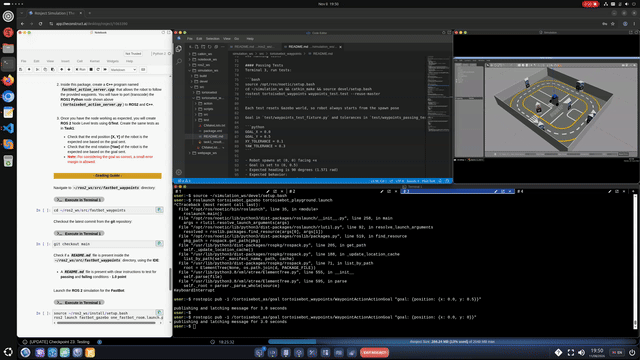

# tortoisebot_waypoints


## Task 1, ROS1 Tests

ROS1 (Noetic) waypoints action server for the TortoiseBot, plus `rostest` node level tests

### Repo Files

#### Code Files
- `action/WaypointAction.action`:
  - Goal: `position`
  - Result: `success`
  - Feedback: `position` and `state`
- `scripts/tortoisebot_action_server.py`: action server `tortoisebot_as`
  1. Turns robot to face the goal
  2. Then drives toward goal
  3. Stops at goal

#### Test Files
- `test/waypoints_test.test`: rostest launch file for the passing tests
- `test/waypoints_failing_test.test`: rostest launch file for the failing tests
- `test/waypoints_test_fixture.py`: shared test fixture, goal is set at the top of the file
- `test/waypoints_passing_test.py`: passing tests (normal tolerances)
- `test/waypoints_failing_test.py`: failing tests (tolerances tighter than the action server can reach)

  Before each test (`setUp`):
  1. Resets the Gazebo world
  2. Sends goal to `tortoisebot_as` and waits for the result
  3. Records the end pose

  Tests check:
  - `test_end_position`: end position **[X, Y]** is within `XY_TOLERANCE` of goal
  - `test_end_yaw`: end rotation **[Yaw]** is within `YAW_TOLERANCE` of expected yaw (from start position)

### Running Simulation and Action Server

Terminal 1, start simulation:

```bash
source /opt/ros/noetic/setup.bash
source ~/simulation_ws/devel/setup.bash
roslaunch tortoisebot_gazebo tortoisebot_playground.launch
```

Terminal 2, action server:

```bash
source /opt/ros/noetic/setup.bash
cd ~/simulation_ws && catkin_make && source devel/setup.bash
rosrun tortoisebot_waypoints tortoisebot_action_server.py
```

Terminal 3, check action server:

```bash
source /opt/ros/noetic/setup.bash
source ~/simulation_ws/devel/setup.bash
rostopic pub -1 /tortoisebot_as/goal tortoisebot_waypoints/WaypointActionActionGoal "goal: {position: {x: 0.0, y: 0.5}}"
```

Expected behavior:
1. Robot turns to face the goal
2. Drives toward goal
3. Terminal 2 logs `fix yaw` / `go to point`

Manual robot reset:
- Place robot back at start, `rosservice call /gazebo/reset_world`

### Running tests

#### Passing Tests
Terminal 3, run tests:

```bash
source /opt/ros/noetic/setup.bash
cd ~/simulation_ws && catkin_make && source devel/setup.bash
rostest tortoisebot_waypoints waypoints_test.test --reuse-master
```

Each test resets Gazebo world, so robot always starts from the spawn pose

Goal in `test/waypoints_test_fixture.py` and tolerances in `test/waypoints_passing_test.py`:

```python
GOAL_X = 0.0
GOAL_Y = 0.5
XY_TOLERANCE = 0.1
YAW_TOLERANCE = 0.3
```

- Robot spawns at (0, 0) facing +x
- Goal is set to (0, 0.5)
- Expected heading is 90 degrees (1.571 rad)
- Expected behavior:
  - Stop within 0.05 m of the goal
  - Keeps heading within 0.25 rad

```
[tortoisebot_waypoints.rosunit-waypoints_passing_test/test_end_position][passed]
[tortoisebot_waypoints.rosunit-waypoints_passing_test/test_end_yaw][passed]

SUMMARY
 * RESULT: SUCCESS
 * TESTS: 2
 * ERRORS: 0
 * FAILURES: 0
```

#### Failing tests

Run the failing tests instead of passing ones (no code changes or rebuild):

```bash
source /opt/ros/noetic/setup.bash
cd ~/simulation_ws && catkin_make && source devel/setup.bash
rostest tortoisebot_waypoints waypoints_failing_test.test --reuse-master
```

`test/waypoints_failing_test.py` sets the error margins tighter than action server can reach (0.05 m and 2 degrees):

```python
XY_TOLERANCE = 0.001
YAW_TOLERANCE = 0.001
```

Both tests fail:

```
[tortoisebot_waypoints.rosunit-waypoints_failing_test/test_end_position][FAILURE]
[tortoisebot_waypoints.rosunit-waypoints_failing_test/test_end_yaw][FAILURE]

SUMMARY
 * RESULT: FAIL
 * TESTS: 2
 * ERRORS: 0
 * FAILURES: 2
```

## Task 1, Result



## Notes

- Action Server commands:
  - Display feedback, `rostopic echo /tortoisebot_as/feedback` (in another terminal)
  - Display result, `rostopic echo /tortoisebot_as/result` (in another terminal, execute before sending goal):
    - Success, `success: True` and `status: 3`
- For ROS1, the forward speed is set to 0.2 m/s instead of 0.6 m/s to prevent rolling after stop and ending up with random heading
